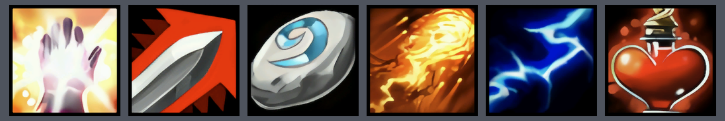

# WoW Forever Icons - Stream Deck PNG Pack (256x256)

A collection of upscaled (256x256) WoW Forever icons pre-converted to PNG format for Elgato Stream Deck, macro pads, and desktop customization.

## Pack Details
- **File Count:** 30,000+ individual icons (complete game asset coverage)
- **Format:** Transparent `.png` (RGBA)
- **Resolution:** 256×256 px (crisp display on Stream Deck 144×144 keys)
- **Compatibility:** Elgato Stream Deck, Loupedeck, Touch Portal, and custom desktop shortcuts

## Downloads
Download the complete zipped pack from the **[Releases](../../releases)** tab.

[-2ea44f?style=for-the-badge&logo=github)](https://github.com/qcy-hash/wow-forever-icons-png/releases/latest/download/png_icons.zip)

## Preview

  

## Credits & Attribution
- **Base Upscaled Pack:** Generated from the upscaled assets by [@hastecraft](https://github.com/hastecraft) via [hastecraft/forever-icons](https://github.com/hastecraft/forever-icons)[cite: 6].
- **Original Artwork:** All icon art belongs to **Blizzard Entertainment**. This is a non-commercial, fan-made community utility[cite: 6].
- **Conversion Utility:** Converted from `.blp` using Python and `Pillow`[cite: 6].

## License
Conversion scripts and documentation are licensed under the MIT License[cite: 6]. All game assets remain copyright © Blizzard Entertainment[cite: 6].
